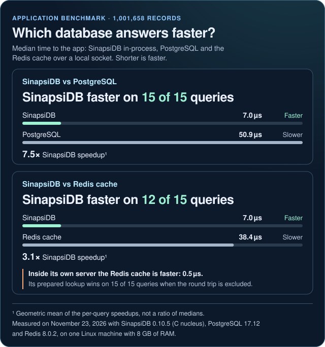
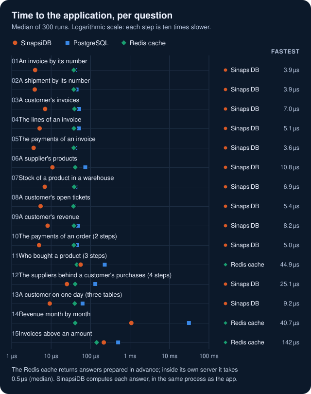

# SinapsiDB

An experimental database where every fact is a threshold neuron. There is no SQL underneath: facts, rules and the
history of what happened live in the same network, and a question is an activation.

Website: [sinapsidb.14bodhi.com](https://sinapsidb.14bodhi.com)

<p align="center"></p>

**Status: experimental, version 0.10.7.** This is a research project, not a database to put in production. It runs
on one machine with one writer at a time, keeps the whole network in memory unless you move it to disk, and its web
portal has no login of its own. The documentation and the code comments are in Italian.

## The idea in a few lines

- **A fact is a neuron.** It receives one synapse from each participant: «invoice 104, customer Ada, Tuesday,
  total 1,200». A question switches on some neurons (Ada, Tuesday), and the facts that receive enough of them fire.
- **Nothing is deleted.** On disk there is a journal that is only ever appended to, plus a snapshot to reopen fast.
  A correction is a new fact that says which facts it withdraws.
- **Rules are neurons too.** A rule such as «an order may not take a customer's remaining credit below zero» is
  written in the network. Every decision leaves a receipt with what it looked at, a refusal included, so it can be
  checked again later from the journal.
- **You ask in writing, without a language model.** SinapsiDB has its own small query language:

  ```
  accendi cliente = C00202 in fattura emessa leggi fattura, totale
  accendi cliente = C00202 in fattura emessa leggi fattura poi in riga di fattura leggi prodotto poi in scheda prodotto leggi distinti fornitore
  in fattura emessa somma totale per mese(quando)
  ```

  It says which neurons to switch on (`accendi`), in which facts (`in`) and what to read (`leggi`), also over
  several steps (`poi`). The engine answers and says how it answered. See [docs/lingua.md](docs/lingua.md).

## How it works

<p align="center"></p>

## What is in this release

| Part | Where | What it does |
|---|---|---|
| Engine | `src/sinapsidb/motore.py`, `rete.py` | the threshold network, the journal and the snapshot |
| Query language | `src/sinapsidb/lingua.py` | read-only; runs questions over several steps |
| Memory and decisions | `src/sinapsidb/memoria.py`, `fido.py`, `attesta.py` | rules, receipts, review of past decisions: [docs/contratto-decisioni.md](docs/contratto-decisioni.md) |
| Compiled nucleus | `src/sinapsidb/nucleo.c`, `nucleo.py` | optional C code for sums over all facts of a type; Python stays the reference |
| Network on disk | `src/sinapsidb/blocchi.py` | keeps in memory only the blocks that questions touch |
| Local portal | `src/sinapsidb/portale.py`, `statici/` | three pages: Decisions, Data, Comparison |
| Benchmark | `src/sinapsidb/confronto.py`, `confronto_redis.py`, `dati_prova.py` | the same questions to SinapsiDB, PostgreSQL and Redis |
| Credit-limit trial | `prove/fido/`, [docs/prova-del-fido.md](docs/prova-del-fido.md) | a protocol and an external judge, written before any number exists |

Not in this release: the MCP connector that lets an assistant talk to SinapsiDB. It will come later.

## Install and try it

You need Linux and Python 3.11 or newer. A C compiler is optional.

```sh
git clone https://github.com/cristianku/sinapsidb.git
cd sinapsidb
installa/installa.sh          # creates .venv, installs, compiles the nucleus if it can
installa/installa.sh avvia    # starts the portal in the foreground on http://127.0.0.1:8419
```

Open <http://127.0.0.1:8419/> and you land on **Decisions**: a small memory with customer credit limits. Grant a
limit, ask for orders, register payments. An order that would take the remaining credit below zero is refused, and
the refusal stays written with what it looked at. *Riesamina* tells you what would have been decided had a later
payment been known; *Verifica* redoes a decision from the journal. Stop the portal with Ctrl-C.

The same by hand:

```sh
python3 -m venv .venv
.venv/bin/pip install -r installa/requirements.lock   # the exact versions used for the measurements
.venv/bin/pip install --no-deps .
.venv/bin/python -m sinapsidb.nucleo compila          # optional, needs a C compiler
SINAPSIDB_METRICHE_DB="$HOME/sinapsidb-dati/metriche.db" .venv/bin/sinapsidb-portale
```

The portal listens only on `127.0.0.1` and checks the source address and the `Host` header. It has no login: do not
open it to a network without a proxy in front that asks for one. Running it as a service, updating, backing up and
restoring: [docs/installare.md](docs/installare.md).

## The comparison with PostgreSQL and Redis

The **Comparison** page generates an invented company of twenty tables in PostgreSQL (customers, orders, invoices,
payments, stock, suppliers, support tickets), imports every record into SinapsiDB as a fact, and asks the same
fifteen questions to both. Every answer from SinapsiDB is compared row by row with PostgreSQL's before anything is
timed. PostgreSQL keeps its keys, indexes and prepared statements, and its execution time inside the server is shown
too.

Redis can be added as a third system. It is a **cache of answers prepared in advance**: it does not answer
questions, it returns what was stored under a key. The page shows what preparing it costs.

On one Linux machine with 8 GB of RAM, with 1,001,658 records: SinapsiDB 0.10.5 with the C nucleus, PostgreSQL
17.12 and Redis 8.0.2, 23 November 2026, median of 300 runs per question. Every answer was checked against
PostgreSQL's before timing, with no mismatch.

<p align="center"></p>

- **As seen by the calling program**, SinapsiDB answered all 15 questions faster than PostgreSQL, 7.5 times as a
  geometric mean of the per-question ratios, and 12 of 15 faster than the Redis cache, 3.1 times.
- **Redis wins three**: who bought a product (three steps), revenue month by month, invoices above an amount.
- **Inside its own server Redis is the fastest of the three**: 0.5 µs, ahead on all 15. As seen by the program
  SinapsiDB is ahead because it answers inside the same process, while Redis is a round trip away and returns
  answers prepared in advance: 460,899 keys, built in 23 seconds.
- **The time to find an invoice by number does not grow with the data**: 2.6 µs with 300,000 records, 2.7 µs with a
  million, in an earlier run.
- **Ten million records** are still to be measured with the C nucleus. Before it, PostgreSQL was up to 17 times
  faster on the questions with no starting point.
- **The price is memory**: about 430 MB for a million records, against the 135 MB that PostgreSQL takes on disk.

<p align="center"></p>

These are numbers from one machine, not a claim. The questions that PostgreSQL or Redis win stay in the comparison.
How it is measured, all the tables, what the numbers do not say and how to reproduce them:
[docs/confronto-postgresql.md](docs/confronto-postgresql.md).

## Tests

```sh
.venv/bin/pip install -e '.[dev]'
.venv/bin/python -m sinapsidb.nucleo compila   # again: the editable install has no compiled nucleus yet
.venv/bin/pytest -q
```

Without the compiled nucleus the tests that compare it with Python are skipped, and the rest run on Python.

The tests that need PostgreSQL or Redis start a private, temporary server that listens only on a socket in a
temporary folder and stops at the end; they never touch a system PostgreSQL or Redis. The PostgreSQL ones need root
and the PostgreSQL binaries in `/usr/lib/postgresql/*/bin`, the Redis ones need `redis-server`. Without them, those
tests are skipped.

Smoke tests against a portal running in the foreground: `scripts/prova_portale.sh`, `scripts/prova_decisioni.sh`
and, with PostgreSQL, `scripts/prova_confronto.sh`.

Some fixtures in `tests/dati/` were written by earlier versions of the engine, to prove that old journals still
open. The short hexadecimal names in them point to the private development history.

## License

Apache License 2.0, see [LICENSE](LICENSE). Made by cristianku.
